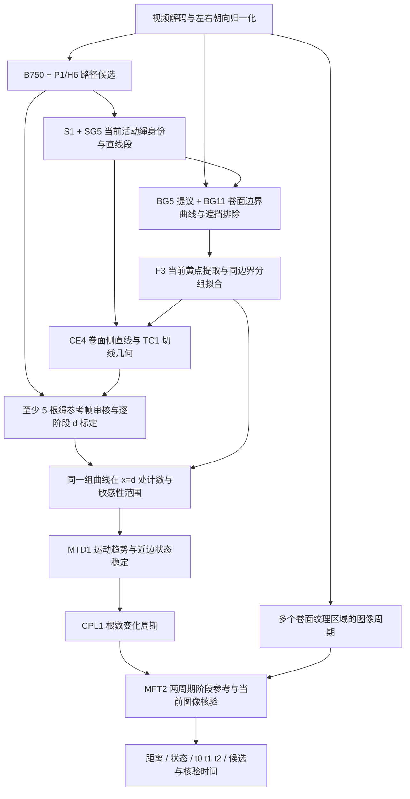
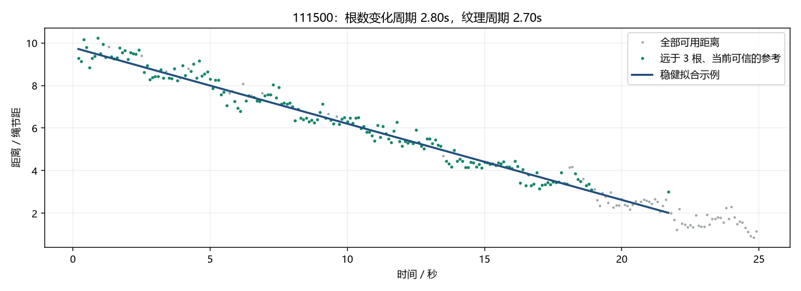
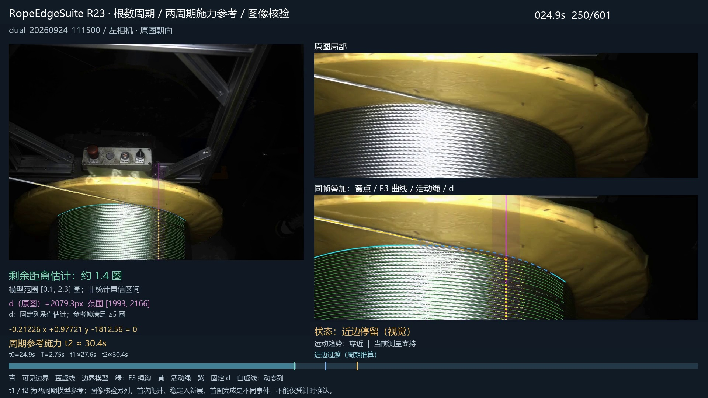
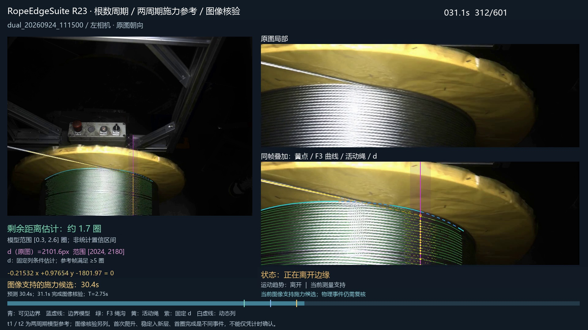
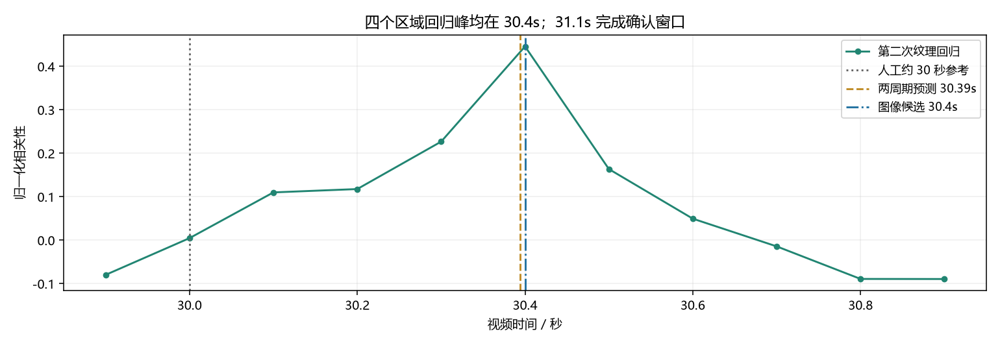

# RopeEdgeSuite R23 — 钢丝绳排绳视觉检测有效基准

**当前有效研发基准：`RES23-1.0.0` · 冻结日期：2026-11-11。**

全称：**钢丝绳排绳边界、计数与换层时序融合算法**（RopeEdgeSuite R23）。本版本将活动绳跟踪、卷面边界、逐视频/运动阶段的 `d` 标定、F3 绳间边界计数、近边状态稳定、转动周期估计和施力时刻候选组成一套可追溯的基准。以后开发应与本版本对照，不能直接覆盖其源码和结果。

“有效”指当前选定、已有视频实验和回归验证支持的**研发基准**。计数是图像投影下的绳距估计，近边和施力输出是视觉证据与模型支持的候选；本仓库没有执行电机控制，也没有宣称完成实体接触或现场闭环验收。

| 入口 | 内容 |
|---|---|
| [当前基准目录](baselines/RES23-1.0.0/README.md) | 冻结源码、依赖、B750 权重、测试、样例与证据 |
| [完整算法原理](baselines/RES23-1.0.0/docs/ALGORITHM.md) | 各阶段输入输出、公式、质量门控和时序逻辑 |
| [运行与应用方法](baselines/RES23-1.0.0/docs/USAGE.md) | 环境、可运行样例、原视频前端检查、完整工程复现与新视频接入 |
| [验证与适用范围](baselines/RES23-1.0.0/docs/VALIDATION.md) | 11 段视频结果、45 项测试、证据边界和已知限制 |
| [生产模块与源码映射](baselines/RES23-1.0.0/docs/SOURCE_MAP.md) | 当前使用的模块和支撑版本，避免选错旧入口 |
| [当前基准机器索引](CURRENT_BASELINE.json) | 唯一当前基准标识、版本状态和目录 |
| [历史版本索引](history/README.md) | 原有 61 个研究版本及升级关系 |

## 完整处理流程



算法包含一个学习型热图前端 **B750**；其后的边缘提取、曲线拟合、几何计数和时序推断主要采用传统视觉与数值方法。因此本完整基准不标为“纯传统、无模型算法”。B750 是已冻结权重，本次没有重新训练。

关键约定：

- 黄色法兰的可见边缘、卷面的可见上限和活动绳边缘分别建模；活动绳及工具遮挡区不直接作为卷面边界拟合点。
- F3 黄点先归入同一条绳间边界，再作鲁棒曲线拟合；显示与计数使用同一组曲线，每个边界编号在 `x=d` 只贡献一次交点。长缺口保留不确定性。
- `d` 按视频和运动阶段标定；直接折弯标定、条件几何估计、当前动态列估计分别标注。历史 `2238.7 px` 不作为所有视频的通用真值。
- “靠近/离开”由距离趋势判断；“近边”由当前测量持续支持。短时历史保持不能作为新的接触、换层或施力证据。
- `t0` 为近边确认；`t1` 为过渡结束、开始稳定绕新层第一圈；`t2` 为第一圈完成、第二圈即将开始的施力目标。首次爬升另行记录。

## 实验结果与图像证据

已有完整视频验证覆盖 **11 段视频、4819 帧**；其中 3 段仅有 9、4、9 帧，不能支持完整时序标定。45 项行为/回归测试通过。R23 仅新增 CPL1/MFT2，R22 的原始计数、`d`、F3 和主状态字段逐帧保持一致。**覆盖率、回归一致性和选例图不等于逐帧物理真值精度。**

对 `dual_20260924_111500__left`：

| 项目 | R23 结果 |
|---|---:|
| 由根数变化估计的周期 | 2.7955 s |
| 图像纹理周期 | 2.7000 s |
| 融合周期 `T` | 2.7469 s |
| 近边确认 `t0` | 24.9 s |
| 稳定绕新层第一圈参考 `t1=t0+T` | 27.6469 s |
| 第一圈完成参考 `t2=t0+2T` | 30.3939 s |
| 图像支持的施力候选 | **30.4 s** |
| 后续图像核验完成时间 | **31.1 s** |

此前 27.3 s 候选偏早，主要是把首次爬升/行重叠变化当成稳定进入新层的起点，混淆阶段定义。新版用两周期阶段模型并加当前图像证据，候选接近人工约 30 s 参考，相差约 +0.4 s。该人工近似时间参与了本轮开发评价，不是独立测试集精度。

**距离趋势支持周期估计。** 绿点是远于 3 根、当前证据合格的周期参考；灰点为其他可用距离。这里的周期参考 `N>3` 与固定 `d` 标定的 `N` 下界至少 5 根是不同门槛。



**近边确认画面，24.9 s。** 原图、同帧边界/F3/活动绳叠加、计数列和状态同时展示。



**31.1 s 完成核验，候选发生于 30.4 s。** 青色是可见边界，蓝虚线是边界模型，绿色是 F3 绳间曲线，黄色是活动绳，紫色是固定计数列。候选时间和核验完成时间分开显示。



**第二周期窗口的纹理核验。** 多个纹理区域的回归峰与当前离边证据联合支持候选；没有足够当前证据时只显示周期参考。



更多跨视频画面与逐视频结果见[验证说明](baselines/RES23-1.0.0/docs/VALIDATION.md)。以上图片直接复制自冻结实验输出；文件 SHA-256、原始视频 SHA-256 和候选结果均有记录，未使用生成图替代实验图。

## 快速运行

在仓库根目录，以 Python 3.12 为例：

```powershell
python -m venv .venv
.\.venv\Scripts\python.exe -m pip install -r baselines/RES23-1.0.0/requirements.txt
.\.venv\Scripts\python.exe baselines/RES23-1.0.0/tools/baseline.py verify
.\.venv\Scripts\python.exe baselines/RES23-1.0.0/tools/baseline.py test
.\.venv\Scripts\python.exe baselines/RES23-1.0.0/tools/baseline.py replay-example --out replay_output/111500.json
```

样例使用仓库中真实视频的冻结测量和纹理特征，重算 CPL1/MFT2，并将全部 601 帧输出与冻结 R23 逐项比较；成功时输出 30.4 s 候选、31.1 s 核验完成。**此命令不是从原视频重新检测 F3。** 原视频前端运行、完整测量流程和数据格式见[应用方法](baselines/RES23-1.0.0/docs/USAGE.md)。

## 当前版本与历史版本

| 范围 | 状态 | 使用原则 |
|---|---|---|
| `baselines/RES23-1.0.0/` | **当前有效基准** | 新研究的默认对照，源码和参数冻结 |
| 本基准 `src/` 下的 R1、R11–R22、LC1 | 当前基准的依赖与演进源码 | 以生产模块映射为准，目录名较旧不代表可以删除 |
| `source_archive/`、原 `VERSION_CATALOG.md` | **历史研究档案** | 保留原始内容，追溯和对照使用，不是当前完整算法入口 |
| R23 之后的改动 | 待验证实验版本 | 独立目录、独立版本；验证后再显式更新 `CURRENT_BASELINE.json` |

历史 61 版的目录和原清单保持不变；旧首页另存于 [history/README_20261103.md](history/README_20261103.md)。本次上传包含当前依赖源码、小型 B750 权重、真实测量样例、精选证据图和验证记录；原始录像、完整结果视频及大规模逐帧缓存继续保留在本地实验目录。详细路径、哈希和运行前提见基准文档。
