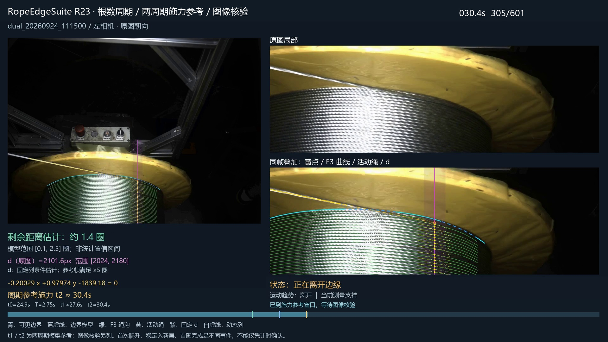
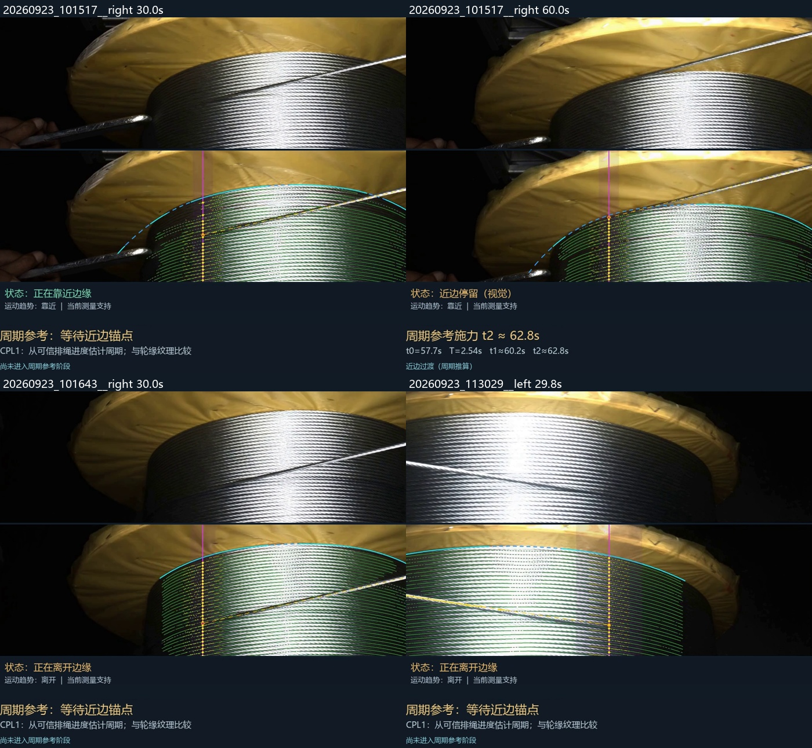
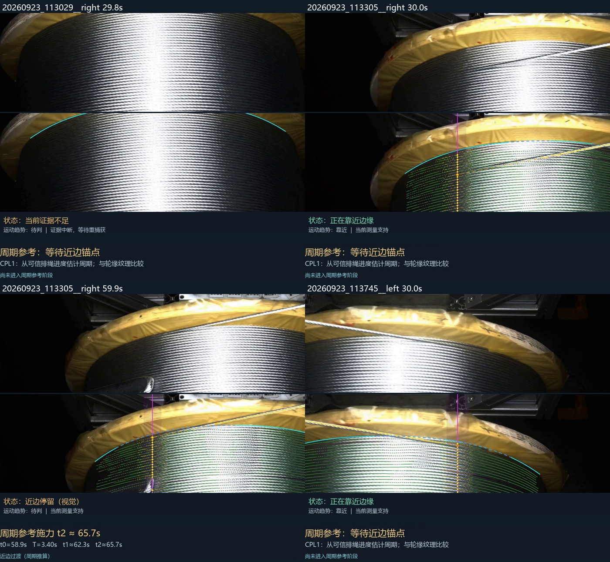
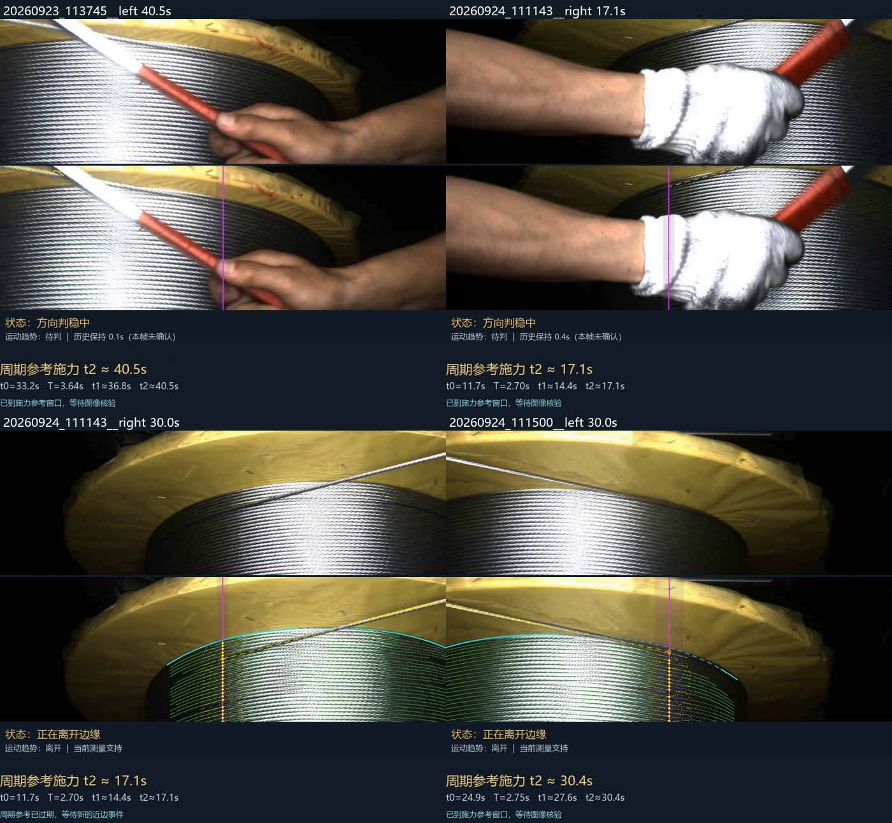
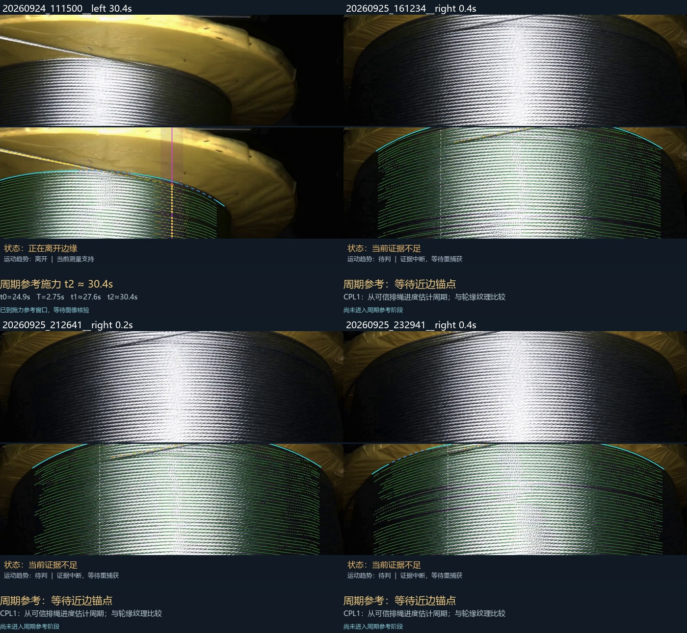

# 验证记录与适用范围

## 本次基准的证据层级

- 原完整视频实验：11 段视频、4819 帧。原记录见 [R23 regression_audit](../evidence/R23/regression_audit.json) 与 [final_verification](../evidence/R23/final_verification.json)。
- 行为/回归测试：45 项，包括缺边、遮挡、镜像、阶段切换、时间原点平移、周期冲突、变速与候选核验时序。发布打包后重新执行全部 45 项并通过。
- 真实测量重放：包内 111500 的 601 帧与全部事件逐项一致，重现 30.4 s 候选和 31.1 s 核验完成。
- 原视频依赖检查：使用包内模型与源码读取 111500 原视频前三帧。第 0 帧跟踪/边界尚未建立，第 1 帧跟踪建立，第 2 帧跟踪与边界建立；无算法异常。见 [前端打包检查](../evidence/frontend_packaging_check.json)。这不是全流程 F3 重跑。
- 本次打包保持实验源码字节不变；原视频完整复测是 R23 实验阶段完成的，本次发布没有声称再次重算全部原视频。

## 11 段视频的周期/施力结果

下表的预测时刻、图像候选和失败原因分列；没有候选不能自动记作误检或漏检，需要对应事件真值判断。三段极短视频仍在 11 段、4819 帧统计中。

| 视频 | 帧数 | t0 / s | t2 参考 / s | 图像候选 / s | 说明 |
|---|---:|---:|---:|---:|---|
| `dual_20260923_101517__right` | 601 | 57.70 | 62.78 | — | 双周期相容，但预测窗口超出片尾，未完成图像核验 |
| `dual_20260923_101643__right` | 601 | — | — | — | 未建立近边锚点，不产生施力事件 |
| `dual_20260923_113029__left` | 597 | — | — | — | 未建立近边锚点，不产生施力事件 |
| `dual_20260923_113029__right` | 596 | — | — | — | 当前活动绳证据不足，无事件；作为拒绝/未知对照保留 |
| `dual_20260923_113305__right` | 600 | 58.90 | 65.70 | — | 仅计数周期，且目标超出片尾，仅参考 |
| `dual_20260923_113745__left` | 600 | 33.20 | 40.47 | — | 仅计数周期；工具遮挡期间不能确认当前施力证据 |
| `dual_20260924_111143__right` | 601 | 11.70 | 17.10 | — | 仅纹理周期；计数历史跨度不足，仅参考 |
| `dual_20260924_111500__left` | 601 | 24.90 | 30.39 | 30.40 | 双周期相容及当前图像支持；31.1 s 完成核验 |
| `dual_20260925_161234__right` | 9 | — | — | — | 极短片段，时序支持不足，无事件 |
| `dual_20260925_212641__right` | 4 | — | — | — | 极短片段，时序支持不足，无事件 |
| `dual_20260925_232941__right` | 9 | — | — | — | 极短片段，时序支持不足，无事件 |

完整数值见 [video_results.json](../evidence/video_results.json)。原 R22 测量/计数/d/F3/主状态字段在 R23 全 4819 帧保持一致；这证明新模块没有改变这些既有输出，不等于那些输出已经全部达到物理真值。

## 111500 人工参考的使用方式

人工约 24.7 s 指首次爬升，约 24.9 s 为近边参考，约 29 s 离开边缘，约 30 s 是新层第一圈完成的施力参考。用户明确 t1 指过渡结束、稳定绕新层第一圈，而非首次爬升。

本轮模型给出 `t1≈27.6469 s`、`t2≈30.3939 s`，图像候选 30.4 s，后续核验 31.1 s。相对人工约 30 s 差 +0.4 s。候选附近的 30.3–30.5 s 是图像时间分辨率范围，不是物理真值置信区间；模型 t2 范围约 29.74–30.94 s 同样是敏感性范围。

人工近似时间用于本轮开发比较，不能把这一个样本的差值当作独立泛化精度。候选来自真实计数与纹理输入，生产 `period23.py` / `fusion23.py` 不读取人工时间文件。完整模型/图像比较见 [evaluation.json](../evidence/R23/evaluation.json)。

## 关键画面

所有图像均直接复制自冻结实验输出，SHA 与来源登记在 [figure_provenance.json](../evidence/figure_provenance.json)。

20.0 s：运动方向显示为靠近边缘，不能把距离尚大误称为正在远离。

30.4 s：处于预测/核验窗口；还不能显示未来 31.1 s 才获得的核验结论。

跨视频选例包括近边、离开、片尾不足、当前活动绳证据不足及工具/手遮挡。以下图集保留无结果例，避免只展示成功画面：

## 已知限制

1. 没有覆盖全部帧的独立人工计数、实体接触和机械转数真值，因此不能给出整体准确率或工业验收结论。
2. 单视角下遮挡、工具、强反光与绳体重叠仍可能使当前测量未知。历史保持只延续显示，不提升证据等级。
3. d 标定可使用本运动阶段后续帧；目前完整流程仍为离线验证，新增时序模块的因果检查不能替代整套在线验证。
4. t0→t1→t2 每阶段约一周期是本场景采用的模型假设；明显变速、排绳滑移、不同过渡规律需要重新检验。
5. 图像核验会晚于候选发生时刻。本版本未发出任何电机命令；若用于提前施力，需要另行设计控制提前量并做现场测量。
6. 分辨率、镜像、帧率和源 SHA 绑定是复现的一部分；不能跨场景沿用旧 d 或忽略丢帧。

“有效基准”意味着冻结的研发比较对象；新的算法版本应同时检查准确性、未知原因、覆盖率和时序延迟，不应以强制输出数值代替正确检测。
